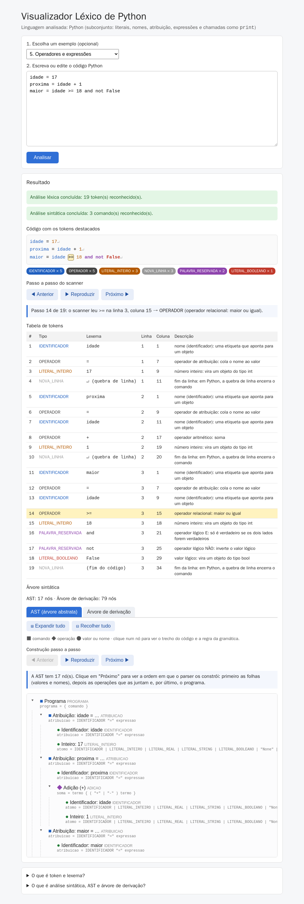
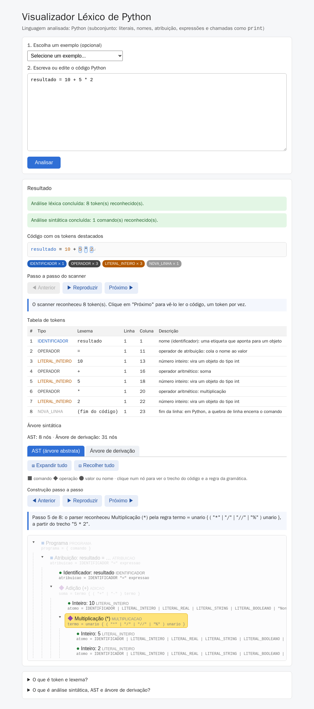
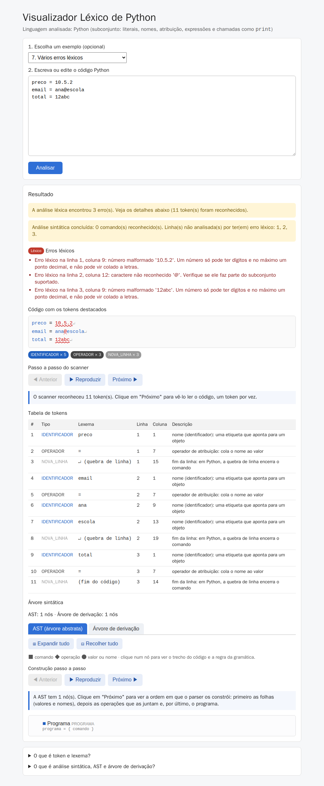
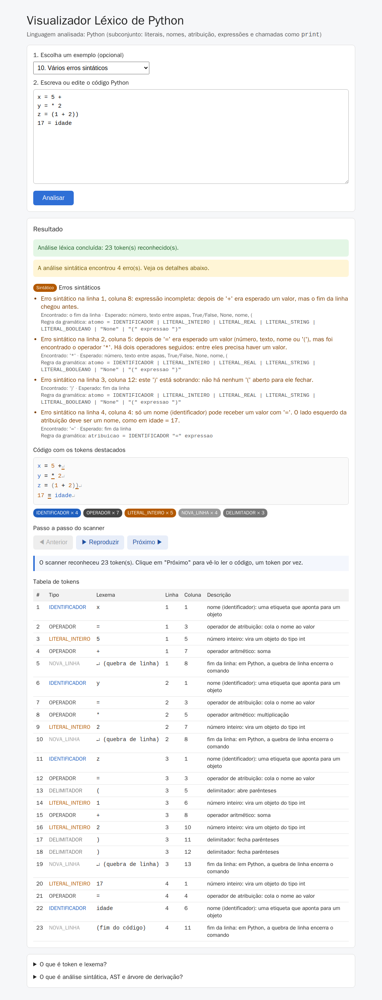

# Visualizador Léxico de Python

Software educacional da disciplina de Compiladores. É uma página web que mostra a alunos do
ensino médio como o Python lê um programa: o analisador léxico (scanner) quebra o código em
tokens e classifica cada valor pela forma como ele foi escrito (`17` é inteiro, `"17"` é string), e
o analisador sintático (parser) organiza esses tokens numa árvore, antes de o programa ser executado.

> **Situação atual (Etapa 4):** a **análise léxica e a sintática estão implementadas**.
> - **Léxico:** o sistema tokeniza o código, mostra cada token com tipo, lexema, linha e coluna,
>   destaca o código em cores e tem um passo a passo do scanner.
> - **Sintático:** o parser verifica a gramática e monta a **AST** e a **árvore de derivação**. As
>   duas são navegáveis, e clicar num nó destaca o trecho do código. A construção da AST pode ser
>   vista passo a passo.
> - **Erros:** os erros léxicos e os sintáticos aparecem separados, com mensagens didáticas e a
>   regra da gramática envolvida.
>
> **A análise semântica (Etapa 5) ainda não existe.** Um código como `x = "a" + 1` é aceito, porque
> está bem formado, embora some texto com número.

Para os alunos, há um tutorial curto em [docs/tutorial.md](docs/tutorial.md).

## Linguagem analisada: Python

Escolhemos Python porque os literais são fáceis de distinguir pela forma escrita, porque é a
linguagem usada em cursos técnicos e porque a biblioteca padrão (`tokenize`) permite conferir o
resultado contra o interpretador real. Os testes fazem exatamente essa conferência.

**Subconjunto tratado:**
- literais (inteiro, real, string, booleano);
- nomes de variáveis e atribuição;
- expressões com operadores aritméticos, relacionais e lógicos;
- parênteses e chamadas de função como `print("Idade:", idade)`;
- comentários.

Exemplo:

```python
idade = 17                          # inteiro
maior = idade >= 18 and not False   # expressão lógica
print("Idade:", idade + 1)
```

**Fica de fora:** `if`, `while`, `for` e outros blocos (e, portanto, a indentação), funções, classes,
listas e dicionários.

## Escopo léxico

| Categoria (`tipo`) | Regra de formação | Exemplos |
| --- | --- | --- |
| `PALAVRA_RESERVADA` | As palavras reservadas do Python. As do subconjunto são `and`, `or`, `not` e `None`. As outras (`if`, `while`, `def`...) também são reconhecidas como reservadas, porque o Python não deixa usá-las como nome | `and`, `or`, `not`, `None` |
| `IDENTIFICADOR` | Letra ou `_`, seguida de letras, dígitos ou `_`. Aceita acentos, como o Python | `idade`, `_x1`, `média` |
| `LITERAL_INTEIRO` | Um ou mais dígitos | `0`, `17` |
| `LITERAL_REAL` | Dígitos com um ponto decimal | `1.75`, `.5`, `3.` |
| `LITERAL_STRING` | Texto entre `"` ou `'`, numa linha só. Aceita escapes como `\"` | `"17"`, `'Ana'` |
| `LITERAL_BOOLEANO` | `True` ou `False` | `True` |
| `OPERADOR` | Aritméticos `+ - * / // % **`, relacionais `== != < > <= >=` e atribuição `=`. Os lógicos são as palavras `and`, `or` e `not` | `+`, `>=`, `**` |
| `DELIMITADOR` | Parênteses e vírgula | `(`, `)`, `,` |
| `NOVA_LINHA` | A quebra de linha que **encerra um comando** (em Python ela faz o papel do `;` do C). Linhas em branco, linhas só de comentário e quebras dentro de parênteses não geram esse token | `↵` |
| Comentários | `#` até o fim da linha. São **ignorados** e não viram token | `# comentário` |
| Espaços em branco | Espaços, tabs e `\r` são **ignorados** e só separam os tokens | |

Quando dois tokens podem começar no mesmo ponto, o scanner escolhe o **maior**: `>=` é um token só,
e não `>` seguido de `=`.

### Erros léxicos

O scanner **não para no primeiro erro**: ele continua lendo e acumula todos, para o aluno ver todos os
problemas de uma vez.

| Erro | Quando acontece | Exemplo de mensagem |
| --- | --- | --- |
| Caractere não reconhecido | Um símbolo fora do subconjunto: `@ $ ? ! : ; [ ] { } \` e outros | `Erro léxico na linha 2, coluna 12: caractere não reconhecido '@'. Verifique se ele faz parte do subconjunto suportado.` |
| String não fechada | A linha acaba antes da aspa de fechamento | `Erro léxico na linha 1, coluna 8: string não fechada "Ana. Toda string precisa terminar com a mesma aspa (") na mesma linha.` |
| Número malformado | Número com dois pontos ou colado a letras: `10.5.2`, `12abc`, `1e5` | `Erro léxico na linha 1, coluna 9: número malformado '10.5.2'. Um número só pode ter dígitos e no máximo um ponto decimal, e não pode vir colado a letras.` |
| Três aspas | `"""texto"""` ou `'''texto'''` | `Erro léxico na linha 1, coluna 1: strings com três aspas não fazem parte do subconjunto suportado.` |

As mensagens nunca mostram detalhes internos do sistema.

## Gramática do subconjunto (EBNF)

A gramática abaixo define o que o parser aceita. Quase todas as decisões são tomadas olhando um único token à frente (LL(1)), o que permite escrevê-la à mão como um analisador descendente recursivo, com uma função por regra. A exceção é `comando`: um `IDENTIFICADOR` pode começar tanto `x = 1` quanto `x + 1`, e o parser olha o segundo token para decidir (LL(2)). As regras estão em ordem de precedência crescente, da mais fraca (or) para a mais forte (atomo), e a repetição { ... } indica associatividade à esquerda. A exceção é potencia, cuja recursão à direita em unario reproduz a associatividade à direita de ** no Python: 2 ** 3 ** 2 é 2 ** (3 ** 2).

```ebnf
programa     = { comando } ;
comando      = ( atribuicao | expressao ) NOVA_LINHA ;
atribuicao   = IDENTIFICADOR "=" expressao ;
expressao    = exp_ou ;
exp_ou       = exp_e { "or" exp_e } ;
exp_e        = exp_nao { "and" exp_nao } ;
exp_nao      = "not" exp_nao | comparacao ;
comparacao   = soma { ( "==" | "!=" | "<" | ">" | "<=" | ">=" ) soma } ;
soma         = termo { ( "+" | "-" ) termo } ;
termo        = unario { ( "*" | "/" | "//" | "%" ) unario } ;
unario       = ( "+" | "-" ) unario | potencia ;
potencia     = primario [ "**" unario ] ;
primario     = atomo { "(" [ argumentos ] ")" } ;
argumentos   = expressao { "," expressao } ;
atomo        = IDENTIFICADOR | LITERAL_INTEIRO | LITERAL_REAL
             | LITERAL_STRING | LITERAL_BOOLEANO | "None" | "(" expressao ")" ;
```

Os símbolos em maiúsculas são tokens produzidos pelo analisador léxico, descritos na tabela de escopo acima. Tudo que não aparece nesta gramática está fora do subconjunto: if, while, for, blocos e indentação, definição de funções e classes, listas, dicionários, atribuição composta (+=) e atribuição múltipla.

A gramática detalhada (terminais e não terminais, precedência, conjuntos FIRST, exemplos válidos e inválidos, recuperação de erros) está em [docs/gramatica.md](docs/gramatica.md). O fluxo completo da análise, incluindo a decisão de rodar o parser mesmo na presença de erro léxico, está em [docs/fluxograma.md](docs/fluxograma.md). Os casos de teste que exercitam cada regra estão em [docs/casos-de-teste.md](docs/casos-de-teste.md).

## O scanner

O scanner fica em [backend/scanner.py](backend/scanner.py) e foi **escrito à mão**, em Python puro.
Ele não usa biblioteca de análise léxica nem gerador (como PLY, ANTLR ou o próprio `tokenize`).

Funcionamento:
1. Percorre o código **caractere a caractere**, guardando a linha e a coluna atuais.
2. Olha o caractere atual para decidir o que vem: letra → nome, dígito → número, aspa → string,
   `#` → comentário, símbolo → operador ou delimitador.
3. Lê o lexema inteiro e classifica: um nome pode ser identificador, palavra reservada ou booleano.
4. Registra o token com tipo, lexema, posição e uma descrição didática.
5. Se nada casar, registra um erro léxico e continua a partir do próximo caractere.

Por que essa escolha:
- **Didática:** o código do scanner é curto e legível. Um aluno consegue acompanhar como cada
  categoria é reconhecida.
- **Simplicidade:** não há dependência nova. O scanner roda no mesmo backend Flask da Etapa 2.
- **Confiabilidade:** um teste automatizado compara a saída com a do `tokenize`, o tokenizador
  oficial do Python, para os programas válidos do subconjunto.

Linhas e colunas começam em 1 e contam caracteres. Acentos e emoji contam como um caractere cada.

## O parser

O parser fica em [backend/parser.py](backend/parser.py). É um **analisador descendente recursivo
escrito à mão**, em Python puro, sem gerador (ANTLR, PLY, Lark) e sem usar o parser do próprio Python.
Ele recebe a lista de tokens do scanner da Etapa 3, que é reaproveitado sem nenhuma alteração.

Funcionamento:
1. **Uma função por regra da gramática.** Por exemplo, `soma()` reconhece
   `soma = termo { ( "+" | "-" ) termo }`: chama `termo()`, e enquanto vier `+` ou `-`, consome o
   operador, chama `termo()` de novo e junta os dois lados num nó `ADICAO` ou `SUBTRACAO`.
2. **Precedência.** Ela sai da ordem das regras: `soma` chama `termo`, que chama `unario`. Por isso
   `*` fica mais embaixo na árvore que `+`, e é calculado antes.
3. **Duas árvores ao mesmo tempo.** Cada função devolve um nó da **AST** (só o que importa para o
   significado) e um nó da **árvore de derivação** (todas as regras aplicadas e todos os tokens).
4. **Erros.** Quando o token não cabe na regra, o parser registra um erro sintático didático e pula
   até o fim do comando (modo pânico, sincronizado em `NOVA_LINHA`).

Por que essa escolha:
- **Didática:** é a estratégia que mais se parece com a gramática. Cada regra do
  [docs/gramatica.md](docs/gramatica.md) corresponde a uma função com o mesmo nome, e o mesmo texto da
  regra aparece na tela, em cada nó e em cada erro.
- **Simplicidade:** não entra dependência nova nem etapa de geração de código no build do Docker.
- **Mensagens melhores:** escrito à mão, o parser sabe o contexto de cada erro, como "depois de '+'
  era esperado um valor" ou "o parêntese aberto na linha 1, coluna 5 não foi fechado". Um gerador
  daria mensagens genéricas como "syntax error".
- **Confiabilidade:** um teste automatizado compara a AST com a do módulo `ast` do próprio Python, para
  conferir precedência e associatividade.
- **Limitações:** a gramática precisa ser escrita sem recursão à esquerda (usa repetição `{ }`), e
  cada regra nova exige uma função nova.

### AST e árvore de derivação

Cada **nó da AST** é um objeto JSON com:

```json
{
  "id": 5,
  "tipo": "MULTIPLICACAO",
  "rotulo": "Multiplicação (*)",
  "atributos": { "operador": "*" },
  "regra": "termo = unario { ( \"*\" | \"/\" | \"//\" | \"%\" ) unario }",
  "linha": 1, "coluna": 18, "linhaFim": 1, "colunaFim": 22,
  "filhos": [ "...dois nós LITERAL_INTEIRO (5 e 2)..." ]
}
```

- **`id`:** a ordem em que o parser construiu o nó. Os filhos sempre nascem antes do pai, e a tela
  usa essa ordem no passo a passo.
- **`regra`:** a regra da gramática que reconheceu o nó.
- **`linha`/`coluna` e `linhaFim`/`colunaFim`:** o trecho do código que o nó cobre.

| Tipo de nó | Atributos | Filhos |
| --- | --- | --- |
| `PROGRAMA` | `comandos` (quantidade) | os comandos, em ordem |
| `ATRIBUICAO` | `nome` | `IDENTIFICADOR` (quem recebe) e a expressão |
| `ADICAO`, `SUBTRACAO`, `MULTIPLICACAO`, `DIVISAO`, `DIVISAO_INTEIRA`, `RESTO`, `POTENCIA`, `E_LOGICO`, `OU_LOGICO` | `operador` | os dois operandos |
| `MENOS_UNARIO`, `MAIS_UNARIO`, `NAO_LOGICO` | `operador` | o operando |
| `COMPARACAO` | `operadores` (lista: `a < b <= c` tem `["<", "<="]`) | os operandos (um a mais que os operadores) |
| `CHAMADA_FUNCAO` | `argumentos` (quantidade) | quem é chamado (ex.: `IDENTIFICADOR print`) e os argumentos |
| `LITERAL_INTEIRO`, `LITERAL_REAL`, `LITERAL_STRING`, `LITERAL_BOOLEANO`, `LITERAL_NONE` | `valor` (o lexema) | nenhum |
| `IDENTIFICADOR` | `nome` | nenhum |

Exemplo, `resultado = 10 + 5 * 2`:

```
■ Programa
└── ■ Atribuição: resultado = …
    ├── ● Identificador: resultado
    └── ◆ Adição (+)
        ├── ● Inteiro: 10
        └── ◆ Multiplicação (*)       ← abaixo da adição: é calculada antes
            ├── ● Inteiro: 5
            └── ● Inteiro: 2
```

A **árvore de derivação** usa dois tipos de nó:
- `{"tipo": "NAO_TERMINAL", "simbolo": "soma", "regra": "...", "filhos": [...]}`;
- `{"tipo": "TERMINAL", "simbolo": "OPERADOR", "lexema": "+", "linha": 1, "coluna": 16}`.

As suas folhas são exatamente os tokens da tabela, na mesma ordem, e um teste confere isso. Ela mostra
o que a AST esconde: os parênteses, o fim de linha e toda a cadeia de regras. Um simples `17` passa por
`expressao → exp_ou → exp_e → exp_nao → comparacao → soma → termo → unario → potencia → primario →
atomo`. Para `resultado = 10 + 5 * 2`, a AST tem 8 nós e a árvore de derivação, 31.

### Erros sintáticos

Cada erro traz o que foi **encontrado**, o que era **esperado**, a **regra** da gramática envolvida e
a posição:

```json
{
  "tipo": "ERRO_SINTATICO",
  "linha": 1, "coluna": 8,
  "encontrado": "o fim da linha",
  "esperado": ["número", "texto entre aspas", "True/False", "None", "nome", "("],
  "regra": "atomo = IDENTIFICADOR | LITERAL_INTEIRO | LITERAL_REAL | LITERAL_STRING | LITERAL_BOOLEANO | \"None\" | \"(\" expressao \")\"",
  "mensagem": "Erro sintático na linha 1, coluna 8: expressão incompleta: depois de '+' era esperado um valor, mas o fim da linha chegou antes."
}
```

Situações tratadas, cada uma com uma mensagem própria:
- token inesperado;
- expressão incompleta (`x = 5 +`);
- operadores seguidos (`x = 1 + * 2`);
- fim inesperado do código (`print(`);
- parêntese não fechado (com a posição onde foi aberto) ou sobrando;
- vírgula faltando ou sobrando nos argumentos;
- palavra reservada no lugar de um nome (`if = 2`);
- palavra fora do subconjunto (`while x`);
- lado esquerdo da atribuição que não é um nome (`17 = idade`);
- atribuição múltipla;
- operador composto (`x += 1` sugere `x = x + 1`);
- dois valores sem operador entre eles;
- expressão aninhada demais.

**Recuperação:** o parser **acumula erros**, um por comando. Depois de um erro, ele pula até a
próxima `NOVA_LINHA` e continua no comando seguinte (modo pânico), o que evita erros em cascata.

### Decisão sobre erros léxicos

Como registrado em [docs/fluxograma.md](docs/fluxograma.md), **o parser roda mesmo quando há erro
léxico**, para que o aluno veja os dois tipos de erro de uma vez. Para não gerar diagnósticos sem
sentido, **o parser pula os comandos que contêm um erro léxico**. Em `x = 1 @ 2`, o scanner descarta o
`@`, e o parser veria `x = 1 2`, apontando uma "falta de operador" que o aluno não cometeu. As linhas
puladas voltam em `linhas_ignoradas`, e a tela avisa: *"Linha(s) não analisada(s) por ter(em) erro
léxico: 1."* Os outros comandos são analisados normalmente, e um erro sintático em outra linha
continua sendo apontado.

## Tecnologias

| Parte | Tecnologia |
| --- | --- |
| Frontend | HTML, CSS e JavaScript puro, servidos pelo Nginx |
| Backend | Python 3.12 + Flask |
| Scanner | Python puro, escrito à mão (`backend/scanner.py`) |
| Parser | Python puro, descendente recursivo escrito à mão (`backend/parser.py`) |
| Visualização das árvores | HTML/CSS/JavaScript puro (listas aninhadas), sem biblioteca gráfica |
| Testes do backend | pytest (test client do Flask) |
| Testes de interface e ponta a ponta | Playwright (Python), rodando num container |
| Ambiente | Docker + Docker Compose |

## Arquitetura

```
navegador → localhost:8080 (Nginx) ─┬→ página (index.html, estilo.css, exemplos.js, app.js, arvore.js)
                                    └→ /api/* → backend:5000 (Flask) → validacao.py → scanner.py → parser.py
```

O fluxo completo de uma análise está desenhado em [docs/fluxograma.md](docs/fluxograma.md).

O Nginx serve a página e repassa as chamadas `/api/` para o Flask. O navegador conversa com um único
endereço (`localhost:8080`). O nome `backend` só existe dentro da rede do Docker, e quem o usa é o
Nginx, não o navegador.

```
.
├── docker-compose.yml        # backend, frontend e (perfil "testes") os testes de navegador
├── backend/                  # API em Flask
│   ├── app.py                # rotas: /api/analisar, /api/saude, erro 500 genérico
│   ├── validacao.py          # regras de validação da entrada
│   ├── scanner.py            # analisador léxico
│   ├── parser.py             # analisador sintático (AST e árvore de derivação)
│   ├── tests/                # testes unitários, diferenciais e de endpoints (pytest)
│   ├── requirements.txt
│   └── Dockerfile
├── frontend/                 # página estática servida pelo Nginx
│   ├── site/
│   │   ├── index.html        # estrutura da tela
│   │   ├── estilo.css        # inclui as cores de cada categoria de token
│   │   ├── exemplos.js       # programas de exemplo
│   │   ├── app.js            # envio, tabela, código colorido e passo a passo do scanner
│   │   └── arvore.js         # erros sintáticos, AST, derivação e construção passo a passo
│   ├── nginx.conf
│   └── Dockerfile
├── testes/                   # testes de implantação, interface e ponta a ponta (Playwright)
└── docs/
    ├── gramatica.md          # gramática formal (EBNF) detalhada
    ├── fluxograma.md         # fluxo de uma análise (para o artigo)
    ├── casos-de-teste.md     # casos de teste e critérios de avaliação (para o artigo)
    ├── materiais-e-metodos.md # decisões técnicas da Etapa 4 (para o artigo)
    ├── tutorial.md           # tutorial para os alunos
    ├── testes.md             # registro das execuções de teste
    └── evidencias/           # prints gerados pelos testes
```

## Pré-requisitos

- [Git](https://git-scm.com/)
- [Docker Desktop](https://www.docker.com/products/docker-desktop/) instalado e **aberto**
  (já inclui o Docker Compose)
  - Docker **24 ou superior** (testado com 29.6)
  - Docker Compose **v2 ou superior** (testado com v5.3), usado como `docker compose`, com espaço

Para conferir:

```bash
docker --version
docker compose version
```

Não é preciso instalar Python nem Node na máquina: tudo roda dentro dos containers.

## Como executar

```bash
git clone https://github.com/MarcoTulioSilv/analisador_lexico_python visualizador-lexico-python
cd visualizador-lexico-python
docker compose up --build -d
```

Depois, abra **http://localhost:8080** no navegador. A página também funciona no celular: na mesma
rede, use `http://<IP-do-computador>:8080`.

O frontend só sobe depois que o backend responde ao `healthcheck`. Para conferir o estado dos serviços:

```bash
docker compose ps        # backend deve aparecer como "healthy"
```

Nenhuma variável de ambiente ou senha é necessária. A única porta usada na máquina é a **8080**.

## Como encerrar

```bash
docker compose down
```

Para remover também as imagens criadas pelo projeto:

```bash
docker compose down --rmi local
```

## Como usar a interface



1. **Escolha um exemplo** no seletor (opcional). O código do exemplo **substitui** o conteúdo do campo.
2. **Escreva, cole ou edite** o código no campo de texto.
3. Clique em **Analisar**. Durante o envio, o botão fica desabilitado e mostra "Enviando...".
4. Veja o resultado:
   - **Resumo:** quantos tokens foram reconhecidos ou quantos erros foram encontrados.
   - **Erros léxicos:** cada erro com a linha, a coluna e uma explicação. Só aparece quando há erros.
   - **Código com os tokens destacados:** cada token na cor da sua categoria, e os erros sublinhados
     em vermelho. O `↵` marca onde cada comando termina. Ao passar o mouse sobre um token, aparece a
     descrição dele.
   - **Contagem por categoria:** quantos tokens de cada tipo. As etiquetas também servem de legenda
     das cores.
   - **Passo a passo do scanner:** com **Próximo ▶** e **◀ Anterior**, ou **▶ Reproduzir** para ver
     a animação, o aluno acompanha o scanner lendo o código um token por vez. O token atual fica
     destacado no código e na tabela, com uma frase como *"Passo 14 de 19: o scanner leu >= na linha
     3, coluna 15 → OPERADOR (operador relacional: maior ou igual)"*.
   - **Tabela de tokens:** número, tipo, lexema, linha, coluna e descrição.
   - **Resumo sintático:** logo abaixo do resumo léxico, quantos comandos foram reconhecidos ou
     quantos erros sintáticos foram encontrados.
   - **Erros sintáticos:** separados dos léxicos, cada grupo com o seu selo (**Léxico** e
     **Sintático**). Cada erro mostra a mensagem, o que foi encontrado, o que era esperado e a regra
     da gramática. No código, o ponto do erro sintático ganha um sublinhado tracejado laranja, e o
     léxico, um ondulado vermelho.
   - **Árvore sintática**, com duas abas:
     - **AST:** árvore navegável. Cada nó mostra uma forma (■ comando, ◆ operação, ● valor ou nome),
       o rótulo, o tipo e a regra da gramática. Os botões **Expandir tudo** e **Recolher tudo**
       controlam a árvore inteira, e as setas ▾/▸ abrem ou fecham um nó. **Clicar num nó** destaca no
       código o trecho que ele cobre e mostra os detalhes (regra, posição e trecho). A **construção
       passo a passo** mostra os nós na ordem em que o parser os cria: os ainda não construídos ficam
       apagados, e o atual fica amarelo.
     - **Árvore de derivação:** a árvore concreta, com todas as regras e todos os tokens. Uma
       explicação e a contagem ("AST: 8 nós · Árvore de derivação: 31 nós") ajudam a comparar as duas.
   - **"O que é token e lexema?"** e **"O que é análise sintática, AST e árvore de derivação?":**
     explicações curtas, que abrem ao clicar.



| Cor do resumo | Situação | Exemplo de mensagem |
| --- | --- | --- |
| Verde | Análise léxica sem erros | `Análise léxica concluída: 19 token(s) reconhecido(s).` |
| Verde | Análise sintática sem erros | `Análise sintática concluída: 3 comando(s) reconhecido(s).` |
| Amarelo | Erro sintático | `A análise sintática encontrou 4 erro(s). Veja os detalhes abaixo.` |
| Amarelo | Linhas puladas por erro léxico | `Análise sintática concluída: 1 comando(s) reconhecido(s). Linha(s) não analisada(s) por ter(em) erro léxico: 1.` |
| Amarelo | Erro léxico ou problema na entrada | `A análise léxica encontrou 3 erro(s). Veja os detalhes abaixo (11 token(s) foram reconhecidos).` / `Informe um código-fonte antes de solicitar a análise.` |
| Vermelho | Falha de comunicação | `Não foi possível comunicar com o servidor. Verifique a conexão e tente novamente.` |
| Vermelho | Erro inesperado no servidor | `Ocorreu um erro inesperado. Tente novamente mais tarde.` |

O código digitado nunca é apagado pelo envio nem pelas mensagens de erro.





### Exemplos disponíveis

| Exemplo | Código | O que demonstra |
| --- | --- | --- |
| 1. Números: inteiro e float | `idade = 17`<br>`altura = 1.75` | `LITERAL_INTEIRO`, `LITERAL_REAL`, atribuição |
| 2. Strings: 17 é diferente de "17" | `idade = 17`<br>`idade_texto = "17"`<br>`nome = "Ana"` | `17` vira `LITERAL_INTEIRO` e `"17"` vira `LITERAL_STRING`: o ponto central do projeto |
| 3. Booleanos e nomes | `aprovado = True`<br>`pendente = False`<br>`situacao = aprovado` | `LITERAL_BOOLEANO` e um nome usado como valor |
| 4. Erro intencional: string não fechada | `nome = "Ana` | Erro léxico de string não fechada |
| 5. Operadores e expressões | `idade = 17`<br>`proxima = idade + 1`<br>`maior = idade >= 18 and not False` | Operadores aritméticos, relacionais (`>=`, um token só) e lógicos (`and`, `not`) |
| 6. Comentários e print | `# média`<br>`nota1 = 7.5`<br>`media = (nota1 + 9) / 2  # divisão`<br>`print("Média:", media)` | Comentários ignorados, delimitadores, chamada de função e a linha de comentário que não gera `NOVA_LINHA` |
| 7. Vários erros léxicos | `preco = 10.5.2`<br>`email = ana@escola`<br>`total = 12abc` | Número malformado e caractere não reconhecido. O scanner continua e mostra os 3 erros (e, por isso, o parser pula as 3 linhas) |
| 8. Precedência: 10 + 5 * 2 | `resultado = 10 + 5 * 2`<br>`subtracao = 20 - 5 - 3`<br>`com_parenteses = (10 + 5) * 2` | Na AST: a multiplicação abaixo da adição, `(20 - 5) - 3` associando à esquerda e os parênteses mudando a árvore |
| 9. Lógica e chamadas de função | `idade = 17`<br>`pode_votar = idade >= 16 and not (idade > 70)`<br>`print("Vota?", pode_votar)` | Comparação, `and` e `not` na AST e uma chamada de função com dois argumentos |
| 10. Vários erros sintáticos | `x = 5 +`<br>`y = * 2`<br>`z = (1 + 2))`<br>`17 = idade` | Expressão incompleta, operador onde se esperava valor, parêntese sobrando e lado esquerdo inválido. O parser se recupera e mostra os 4 erros |

## Comunicação entre frontend e backend

### `POST /api/analisar`

Requisição (JSON):

```json
{ "codigo": "idade = 17" }
```

Resposta **200**, quando o código foi analisado, **com ou sem erros léxicos ou sintáticos**:

```json
{
  "sucesso": true,
  "tokens": [
    { "tipo": "IDENTIFICADOR", "lexema": "idade", "linha": 1, "coluna": 1,
      "descricao": "nome (identificador): uma etiqueta que aponta para um objeto" },
    { "tipo": "OPERADOR", "lexema": "=", "linha": 1, "coluna": 7,
      "descricao": "operador de atribuição: cola o nome ao valor" },
    { "tipo": "LITERAL_INTEIRO", "lexema": "17", "linha": 1, "coluna": 9,
      "descricao": "número inteiro: vira um objeto do tipo int" },
    { "tipo": "NOVA_LINHA", "lexema": "", "linha": 1, "coluna": 11,
      "descricao": "fim da linha: em Python, a quebra de linha encerra o comando" }
  ],
  "erros": [],
  "ast": {
    "id": 4, "tipo": "PROGRAMA", "rotulo": "Programa", "atributos": { "comandos": 1 },
    "regra": "programa = { comando }", "linha": 1, "coluna": 1, "linhaFim": 1, "colunaFim": 10,
    "filhos": [ "...ATRIBUICAO(IDENTIFICADOR idade, LITERAL_INTEIRO 17)..." ]
  },
  "derivacao": { "tipo": "NAO_TERMINAL", "simbolo": "programa", "regra": "programa = { comando }",
                 "filhos": [ "..." ] },
  "erros_sintaticos": [],
  "linhas_ignoradas": []
}
```

Com erro sintático, por exemplo `x = 5 +`, a resposta continua sendo 200:

```json
{
  "sucesso": false,
  "tokens": [ "...x, =, 5, + e o fim de linha..." ],
  "erros": [],
  "ast": null,
  "derivacao": null,
  "erros_sintaticos": [
    { "tipo": "ERRO_SINTATICO", "linha": 1, "coluna": 8, "encontrado": "o fim do código",
      "esperado": ["número", "texto entre aspas", "True/False", "None", "nome", "("],
      "regra": "atomo = IDENTIFICADOR | ... | \"(\" expressao \")\"",
      "mensagem": "Erro sintático na linha 1, coluna 8: expressão incompleta: depois de '+' era esperado um valor, mas o fim do código chegou antes." }
  ],
  "linhas_ignoradas": []
}
```

Com erro léxico, por exemplo `x = 1 @ 2` seguido de `y = 2 + 3`, a linha 1 é pulada pelo parser e a
linha 2 vira a AST:

```json
{
  "sucesso": false,
  "tokens": [ "..." ],
  "erros": [
    { "tipo": "ERRO_LEXICO", "lexema": "@", "linha": 1, "coluna": 7,
      "mensagem": "Erro léxico na linha 1, coluna 7: caractere não reconhecido '@'. Verifique se ele faz parte do subconjunto suportado." }
  ],
  "ast": { "tipo": "PROGRAMA", "filhos": [ "...ATRIBUICAO y = 2 + 3..." ] },
  "derivacao": { "...": "..." },
  "erros_sintaticos": [],
  "linhas_ignoradas": [1]
}
```

Campos da resposta 200:
- **`sucesso`:** `true` só se não houve **nenhum** erro, nem léxico nem sintático (a partir da Etapa 4).
- **`tokens`:** os tokens reconhecidos, na ordem em que aparecem. A `NOVA_LINHA` do fim do código
  tem lexema `""`. Igual à Etapa 3.
- **`erros`:** os erros léxicos encontrados, na ordem em que aparecem. Igual à Etapa 3.
- **`ast`:** a árvore sintática abstrata, ou `null` se houve erro sintático.
- **`derivacao`:** a árvore de derivação, ou `null` se houve erro sintático.
- **`erros_sintaticos`:** os erros sintáticos, um por comando com problema.
- **`linhas_ignoradas`:** as linhas dos comandos que o parser pulou por terem erro léxico.

Erros léxicos e sintáticos **não são erros de requisição**: a requisição era válida, e quem encontrou
o problema foi a análise. Por isso a resposta é 200, com `sucesso: false`.

Respostas de erro da requisição (iguais às da Etapa 2):

| Situação | HTTP | Resposta |
| --- | --- | --- |
| Corpo ausente, que não é JSON ou JSON malformado | 400 | `{"recebido": false, "erro": "Requisição inválida: envie um JSON no formato {\"codigo\": \"...\"}."}` |
| Campo `codigo` ausente ou que não é texto | 400 | `{"recebido": false, "erro": "O campo \"codigo\" é obrigatório e deve ser um texto."}` |
| Código vazio ou só com espaços, tabs ou quebras de linha | 400 | `{"recebido": false, "erro": "Informe um código-fonte antes de solicitar a análise."}` |
| Mais de 10.000 caracteres | 400 | `{"recebido": false, "erro": "O código excede o limite de 10.000 caracteres."}` |
| Erro inesperado no servidor | 500 | `{"recebido": false, "erro": "Erro interno no servidor. Tente novamente mais tarde."}` |

As validações acontecem nos dois lados: o navegador barra o campo vazio antes de enviar, e o
backend repete a validação, porque não se deve confiar só na interface.

### `GET /api/saude`

Responde `200 {"status": "ok"}`. É usado pelo `healthcheck` do Docker Compose.

> **Mudanças em relação às etapas anteriores:**
> - **Etapa 4:** a resposta 200 ganhou `ast`, `derivacao`, `erros_sintaticos` e `linhas_ignoradas`.
>   `tokens` e `erros` não mudaram. **`sucesso` mudou de significado:** antes valia só para o léxico e
>   agora exige que também não haja erro sintático. Por isso `= = 17`, que dava `sucesso: true` na
>   Etapa 3, agora dá `false` (caso CT-17).
> - **Etapa 3:** a resposta 200 de `/api/analisar`, que era `{"recebido", "mensagem", "linhas",
>   "caracteres"}`, foi substituída por `{"sucesso", "tokens", "erros"}`.
> - **Etapa 2:** `/api/hello` e a tela "Hello, World!" foram substituídos.

## Testes

São dois conjuntos, e os dois rodam via Docker:

```bash
# 1. Backend: scanner e parser (unitários + comparação com o Python real), validação e endpoints
docker compose run --rm backend pytest -v

# 2. Navegador: implantação, interface, análise léxica e sintática e ponta a ponta (Playwright)
#    Sobe backend e frontend automaticamente, se ainda não estiverem de pé.
#    Na primeira vez, baixa a imagem do Playwright (~1,5 GB).
docker compose --profile testes run --rm testes
```

| Arquivo | Tipo | O que verifica |
| --- | --- | --- |
| `backend/tests/test_scanner.py` | Unitário | Cada categoria de token, maior casamento, posição, `NOVA_LINHA`, cada erro léxico, acúmulo de erros e casos de borda |
| `backend/tests/test_scanner_vs_python.py` | Diferencial | Lexemas, linhas e colunas iguais aos do `tokenize` do Python para os programas válidos |
| `backend/tests/test_parser.py` | Unitário | Cada construção da gramática, precedência e associatividade, formato e posição dos nós, árvore de derivação, cada tipo de erro sintático (encontrado, esperado, regra), recuperação, comandos com erro léxico, limites e casos de borda (CT-01 a CT-27) |
| `backend/tests/test_parser_vs_python.py` | Diferencial | A AST tem a mesma estrutura que a do módulo `ast` do Python para os programas válidos, e tudo o que o parser recusa o Python também recusa |
| `backend/tests/test_validacao.py` | Unitário | Regras de validação da entrada |
| `backend/tests/test_api.py` | Endpoints | Tokens, erros, AST, erros sintáticos e linhas ignoradas no formato do contrato, códigos HTTP, entradas inválidas, aninhamento extremo sem erro 500, erro 500 sem detalhes internos |
| `testes/test_implantacao.py` | Implantação | Página e arquivos servidos, backend acessível *através do Nginx* |
| `testes/test_interface.py` | Interface | Elementos da tela, edição, caracteres especiais e cada exemplo |
| `testes/test_analise_lexica.py` | Interface | Tabela, código colorido, contagem, erros, passo a passo, entradas inválidas, HTML no código, celular e prints |
| `testes/test_arvore.py` | Interface | Resumo sintático, AST (precedência visível, forma/tipo/regra de cada nó), seleção de nó com destaque no código, expandir/recolher, aba de derivação, construção passo a passo, erros sintáticos (esperado, encontrado, regra, sublinhado), distinção entre erro léxico e sintático, linhas puladas, consistência entre a derivação e a tabela de tokens, entradas inválidas e grandes, celular e prints |
| `testes/test_ponta_a_ponta.py` | Integração e ponta a ponta | Digitar → analisar → resultado; validação no navegador; erro do backend; falha de rede; erro 500 |

Os conjuntos juntos funcionam como **testes de regressão** e devem ser rodados a cada mudança. Os
prints em `docs/evidencias/` (`interface.png`, `erros-lexicos.png`, `celular.png`,
`arvore-sintatica.png`, `arvore-derivacao.png`, `erros-sintaticos.png`, `celular-arvore.png`) são
gerados pelos próprios testes. Os casos de teste planejados para o artigo, e onde cada um é testado,
estão em [docs/casos-de-teste.md](docs/casos-de-teste.md).

**Resultado mais recente:** 533 testes, todos aprovados (416 do backend e 117 de navegador). O
histórico de execuções, com comandos, contagens e falhas corrigidas, fica em
[docs/testes.md](docs/testes.md).

## Limitações conhecidas

- **Ainda não há análise semântica (Etapa 5).** O parser aceita código bem formado que não faz
  sentido quando executado:
  - `x = "a" + 1` (texto mais número);
  - `print(y)` sem `y` ter recebido valor;
  - `1(2)` (chamar um número).

  Verificar tipos e nomes é trabalho da próxima etapa.
- **Fora do escopo sintático:**
  - blocos (`if`, `while`, `for`, `def`);
  - `+=`;
  - atribuição múltipla;
  - tuplas, listas e dicionários;
  - vírgula final nos argumentos (`f(1,)`, que o Python aceita);
  - strings coladas (`"a" "b"`).

  Todos esses casos geram erro sintático explicado ([docs/gramatica.md](docs/gramatica.md)).
- **Uma linha com erro léxico não é analisada pelo parser.** Os erros sintáticos dessa linha só
  aparecem depois que o erro léxico é corrigido.
- **Profundidade limitada:** até 35 níveis de parênteses e até 248 operações seguidas numa expressão.
  Além disso, o parser mostra um erro explicando o limite.
- **Fora do escopo léxico:**
  - blocos e indentação (`if`, `while`...);
  - números com `_` (`1_000`), hexadecimais (`0xff`) e com expoente (`1e5`);
  - strings de três aspas;
  - prefixos de string (`f"..."`, `r"..."`);
  - operadores bit a bit (`& | ^ ~`);
  - `:`, `[]`, `{}`, `.` e `;`.

  A maioria desses casos gera erro léxico. Há duas exceções, que não geram erro mas são lidas de
  forma diferente do Python:
  - strings com prefixo, como `f"x"`, aparecem como o identificador `f` seguido de uma string;
  - operadores como `+=` e `<<` aparecem como dois operadores separados (`+` e `=`). O parser aponta
    o erro e sugere a forma correta (`x = x + 1`).
- As árvores são listas indentadas, sem desenho gráfico com linhas. Isso é legível no celular e por
  leitores de tela, mas programas grandes geram árvores longas, que rolam dentro do próprio quadro.
- O campo de código é um `textarea` simples, sem realce enquanto se digita. O código colorido aparece
  depois da análise.
- O limite é de 10.000 caracteres por envio.
- Escolher um exemplo substitui o código do campo sem pedir confirmação.
- O backend usa o servidor de desenvolvimento do Flask, que é suficiente para uso em sala, mas não para produção.

## Próximas etapas

1. **Etapa 5:** análise semântica sobre a AST desta etapa, com tabela de símbolos, nomes usados antes
   de receber valor e tipos incompatíveis (como `"a" + 1`)
2. **Etapa 6:** representação semântica

## Autor

Marco Túlio Silva Oliveira — Disciplina de Compiladores
