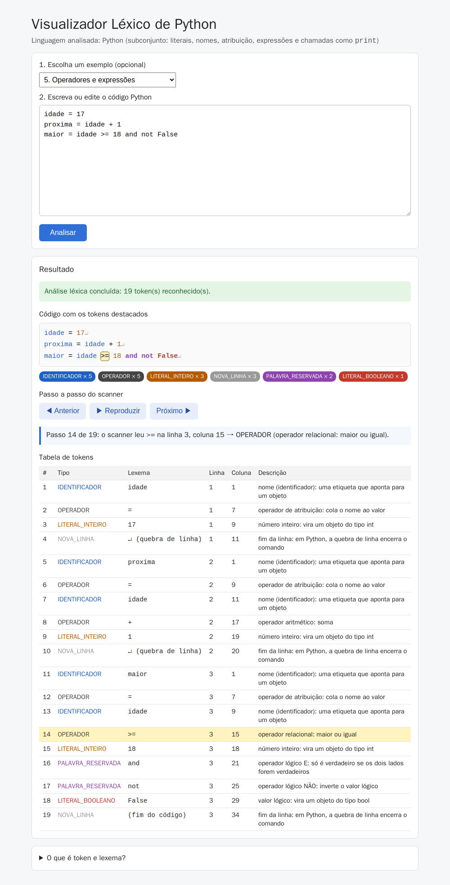
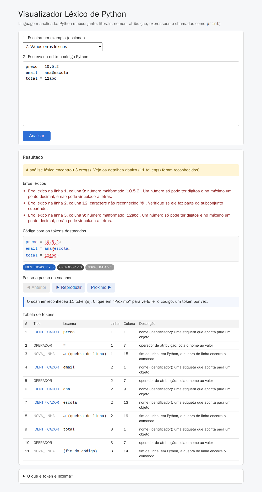

# Visualizador Léxico de Python

Software educacional da disciplina de Compiladores. É uma página web que mostra a alunos do
ensino médio como o Python lê um programa: o analisador léxico (scanner) quebra o código em
tokens e classifica cada valor pela forma como ele foi escrito (`17` é inteiro, `"17"` é string),
antes de o programa ser executado.

> **Situação atual (Etapa 3):** a **análise léxica está implementada**. O sistema tokeniza o código,
> mostra cada token com tipo, lexema, linha e coluna, destaca o código em cores, tem um passo a passo
> do scanner e aponta os erros léxicos com mensagens didáticas. **A análise sintática (Etapa 4) e a
> semântica (Etapa 5) ainda não existem**: um código com tokens válidos, mas sem sentido (como
> `= = 17`), é tokenizado normalmente.

Para os alunos, há um tutorial curto em [docs/tutorial.md](docs/tutorial.md).

## Linguagem analisada: Python

Escolhemos Python porque os literais são fáceis de distinguir pela forma escrita, porque é a
linguagem usada em cursos técnicos e porque a biblioteca padrão (`tokenize`) permite conferir o
resultado contra o interpretador real. Os testes fazem exatamente essa conferência.

**Subconjunto tratado:**
- literais (inteiro, real, string, booleano);
- nomes de variáveis e atribuição;
- expressões com operadores aritméticos, relacionais e lógicos;
- parênteses e chamadas de função como `print("Idade:", idade)`;
- comentários.

Exemplo:

```python
idade = 17                          # inteiro
maior = idade >= 18 and not False   # expressão lógica
print("Idade:", idade + 1)
```

**Fica de fora:** `if`, `while`, `for` e outros blocos (e, portanto, a indentação), funções, classes,
listas e dicionários.

## Escopo léxico

| Categoria (`tipo`) | Regra de formação | Exemplos |
| --- | --- | --- |
| `PALAVRA_RESERVADA` | As palavras reservadas do Python. As do subconjunto são `and`, `or`, `not` e `None`. As outras (`if`, `while`, `def`...) também são reconhecidas como reservadas, porque o Python não deixa usá-las como nome | `and`, `or`, `not`, `None` |
| `IDENTIFICADOR` | Letra ou `_`, seguida de letras, dígitos ou `_`. Aceita acentos, como o Python | `idade`, `_x1`, `média` |
| `LITERAL_INTEIRO` | Um ou mais dígitos | `0`, `17` |
| `LITERAL_REAL` | Dígitos com um ponto decimal | `1.75`, `.5`, `3.` |
| `LITERAL_STRING` | Texto entre `"` ou `'`, numa linha só. Aceita escapes como `\"` | `"17"`, `'Ana'` |
| `LITERAL_BOOLEANO` | `True` ou `False` | `True` |
| `OPERADOR` | Aritméticos `+ - * / // % **`, relacionais `== != < > <= >=` e atribuição `=`. Os lógicos são as palavras `and`, `or` e `not` | `+`, `>=`, `**` |
| `DELIMITADOR` | Parênteses e vírgula | `(`, `)`, `,` |
| `NOVA_LINHA` | A quebra de linha que **encerra um comando** (em Python ela faz o papel do `;` do C). Linhas em branco, linhas só de comentário e quebras dentro de parênteses não geram esse token | `↵` |
| Comentários | `#` até o fim da linha. São **ignorados** e não viram token | `# comentário` |
| Espaços em branco | Espaços, tabs e `\r` são **ignorados** e só separam os tokens | |

Quando dois tokens podem começar no mesmo ponto, o scanner escolhe o **maior**: `>=` é um token só,
e não `>` seguido de `=`.

### Erros léxicos

O scanner **não para no primeiro erro**: ele continua lendo e acumula todos, para o aluno ver todos os
problemas de uma vez.

| Erro | Quando acontece | Exemplo de mensagem |
| --- | --- | --- |
| Caractere não reconhecido | Um símbolo fora do subconjunto: `@ $ ? ! : ; [ ] { } \` e outros | `Erro léxico na linha 2, coluna 12: caractere não reconhecido '@'. Verifique se ele faz parte do subconjunto suportado.` |
| String não fechada | A linha acaba antes da aspa de fechamento | `Erro léxico na linha 1, coluna 8: string não fechada "Ana. Toda string precisa terminar com a mesma aspa (") na mesma linha.` |
| Número malformado | Número com dois pontos ou colado a letras: `10.5.2`, `12abc`, `1e5` | `Erro léxico na linha 1, coluna 9: número malformado '10.5.2'. Um número só pode ter dígitos e no máximo um ponto decimal, e não pode vir colado a letras.` |
| Três aspas | `"""texto"""` ou `'''texto'''` | `Erro léxico na linha 1, coluna 1: strings com três aspas não fazem parte do subconjunto suportado.` |

As mensagens nunca mostram detalhes internos do sistema.

## O scanner

O scanner fica em [backend/scanner.py](backend/scanner.py) e foi **escrito à mão**, em Python puro.
Ele não usa biblioteca de análise léxica nem gerador (como PLY, ANTLR ou o próprio `tokenize`).

Funcionamento:
1. Percorre o código **caractere a caractere**, guardando a linha e a coluna atuais.
2. Olha o caractere atual para decidir o que vem: letra → nome, dígito → número, aspa → string,
   `#` → comentário, símbolo → operador ou delimitador.
3. Lê o lexema inteiro e classifica: um nome pode ser identificador, palavra reservada ou booleano.
4. Registra o token com tipo, lexema, posição e uma descrição didática.
5. Se nada casar, registra um erro léxico e continua a partir do próximo caractere.

Por que essa escolha:
- **Didática:** o código do scanner é curto e legível. Um aluno consegue acompanhar como cada
  categoria é reconhecida.
- **Simplicidade:** não há dependência nova. O scanner roda no mesmo backend Flask da Etapa 2.
- **Confiabilidade:** um teste automatizado compara a saída com a do `tokenize`, o tokenizador
  oficial do Python, para os programas válidos do subconjunto.

Linhas e colunas começam em 1 e contam caracteres. Acentos e emoji contam como um caractere cada.

## Tecnologias

| Parte | Tecnologia |
| --- | --- |
| Frontend | HTML, CSS e JavaScript puro, servidos pelo Nginx |
| Backend | Python 3.12 + Flask |
| Scanner | Python puro, escrito à mão (`backend/scanner.py`) |
| Testes do backend | pytest (test client do Flask) |
| Testes de interface e ponta a ponta | Playwright (Python), rodando num container |
| Ambiente | Docker + Docker Compose |

## Arquitetura

```
navegador → localhost:8080 (Nginx) ─┬→ página (index.html, estilo.css, exemplos.js, app.js)
                                    └→ /api/* → backend:5000 (Flask) → validacao.py → scanner.py
```

O Nginx serve a página e repassa as chamadas `/api/` para o Flask. O navegador conversa com um único
endereço (`localhost:8080`). O nome `backend` só existe dentro da rede do Docker, e quem o usa é o
Nginx, não o navegador.

```
.
├── docker-compose.yml        # backend, frontend e (perfil "testes") os testes de navegador
├── backend/                  # API em Flask
│   ├── app.py                # rotas: /api/analisar, /api/saude, erro 500 genérico
│   ├── validacao.py          # regras de validação da entrada
│   ├── scanner.py            # analisador léxico
│   ├── tests/                # testes unitários, diferencial e de endpoints (pytest)
│   ├── requirements.txt
│   └── Dockerfile
├── frontend/                 # página estática servida pelo Nginx
│   ├── site/
│   │   ├── index.html        # estrutura da tela
│   │   ├── estilo.css        # inclui as cores de cada categoria de token
│   │   ├── exemplos.js       # programas de exemplo
│   │   └── app.js            # envio, tabela, código colorido e passo a passo
│   ├── nginx.conf
│   └── Dockerfile
├── testes/                   # testes de implantação, interface e ponta a ponta (Playwright)
└── docs/
    ├── tutorial.md           # tutorial para os alunos
    ├── testes.md             # registro das execuções de teste
    └── evidencias/           # prints gerados pelos testes
```

## Pré-requisitos

- [Git](https://git-scm.com/)
- [Docker Desktop](https://www.docker.com/products/docker-desktop/) instalado e **aberto**
  (já inclui o Docker Compose)
  - Docker **24 ou superior** (testado com 29.6)
  - Docker Compose **v2 ou superior** (testado com v5.3), usado como `docker compose`, com espaço

Para conferir:

```bash
docker --version
docker compose version
```

Não é preciso instalar Python nem Node na máquina: tudo roda dentro dos containers.

## Como executar

```bash
git clone https://github.com/MarcoTulioSilv/analisador_lexico_python visualizador-lexico-python
cd visualizador-lexico-python
docker compose up --build -d
```

Depois, abra **http://localhost:8080** no navegador. A página também funciona no celular: na mesma
rede, use `http://<IP-do-computador>:8080`.

O frontend só sobe depois que o backend responde ao `healthcheck`. Para conferir o estado dos serviços:

```bash
docker compose ps        # backend deve aparecer como "healthy"
```

Nenhuma variável de ambiente ou senha é necessária. A única porta usada na máquina é a **8080**.

## Como encerrar

```bash
docker compose down
```

Para remover também as imagens criadas pelo projeto:

```bash
docker compose down --rmi local
```

## Como usar a interface



1. **Escolha um exemplo** no seletor (opcional). O código do exemplo **substitui** o conteúdo do campo.
2. **Escreva, cole ou edite** o código no campo de texto.
3. Clique em **Analisar**. Durante o envio, o botão fica desabilitado e mostra "Enviando...".
4. Veja o resultado:
   - **Resumo:** quantos tokens foram reconhecidos ou quantos erros foram encontrados.
   - **Erros léxicos:** cada erro com a linha, a coluna e uma explicação. Só aparece quando há erros.
   - **Código com os tokens destacados:** cada token na cor da sua categoria, e os erros sublinhados
     em vermelho. O `↵` marca onde cada comando termina. Ao passar o mouse sobre um token, aparece a
     descrição dele.
   - **Contagem por categoria:** quantos tokens de cada tipo. As etiquetas também servem de legenda
     das cores.
   - **Passo a passo do scanner:** com **Próximo ▶** e **◀ Anterior**, ou **▶ Reproduzir** para ver
     a animação, o aluno acompanha o scanner lendo o código um token por vez. O token atual fica
     destacado no código e na tabela, com uma frase como *"Passo 14 de 19: o scanner leu >= na linha
     3, coluna 15 → OPERADOR (operador relacional: maior ou igual)"*.
   - **Tabela de tokens:** número, tipo, lexema, linha, coluna e descrição.
   - **"O que é token e lexema?":** uma explicação curta, que abre ao clicar.

| Cor do resumo | Situação | Exemplo de mensagem |
| --- | --- | --- |
| Verde | Análise léxica sem erros | `Análise léxica concluída: 19 token(s) reconhecido(s).` |
| Amarelo | Erro léxico ou problema na entrada | `A análise léxica encontrou 3 erro(s). Veja os detalhes abaixo (11 token(s) foram reconhecidos).` / `Informe um código-fonte antes de solicitar a análise.` |
| Vermelho | Falha de comunicação | `Não foi possível comunicar com o servidor. Verifique a conexão e tente novamente.` |
| Vermelho | Erro inesperado no servidor | `Ocorreu um erro inesperado. Tente novamente mais tarde.` |

O código digitado nunca é apagado pelo envio nem pelas mensagens de erro.



### Exemplos disponíveis

| Exemplo | Código | O que demonstra |
| --- | --- | --- |
| 1. Números: inteiro e float | `idade = 17`<br>`altura = 1.75` | `LITERAL_INTEIRO`, `LITERAL_REAL`, atribuição |
| 2. Strings: 17 é diferente de "17" | `idade = 17`<br>`idade_texto = "17"`<br>`nome = "Ana"` | `17` vira `LITERAL_INTEIRO` e `"17"` vira `LITERAL_STRING`: o ponto central do projeto |
| 3. Booleanos e nomes | `aprovado = True`<br>`pendente = False`<br>`situacao = aprovado` | `LITERAL_BOOLEANO` e um nome usado como valor |
| 4. Erro intencional: string não fechada | `nome = "Ana` | Erro léxico de string não fechada |
| 5. Operadores e expressões | `idade = 17`<br>`proxima = idade + 1`<br>`maior = idade >= 18 and not False` | Operadores aritméticos, relacionais (`>=`, um token só) e lógicos (`and`, `not`) |
| 6. Comentários e print | `# média`<br>`nota1 = 7.5`<br>`media = (nota1 + 9) / 2  # divisão`<br>`print("Média:", media)` | Comentários ignorados, delimitadores, chamada de função e a linha de comentário que não gera `NOVA_LINHA` |
| 7. Vários erros léxicos | `preco = 10.5.2`<br>`email = ana@escola`<br>`total = 12abc` | Número malformado e caractere não reconhecido. O scanner continua e mostra os 3 erros |

## Comunicação entre frontend e backend

### `POST /api/analisar`

Requisição (JSON):

```json
{ "codigo": "idade = 17" }
```

Resposta **200**, quando o código foi analisado, **com ou sem erros léxicos**:

```json
{
  "sucesso": true,
  "tokens": [
    { "tipo": "IDENTIFICADOR", "lexema": "idade", "linha": 1, "coluna": 1,
      "descricao": "nome (identificador): uma etiqueta que aponta para um objeto" },
    { "tipo": "OPERADOR", "lexema": "=", "linha": 1, "coluna": 7,
      "descricao": "operador de atribuição: cola o nome ao valor" },
    { "tipo": "LITERAL_INTEIRO", "lexema": "17", "linha": 1, "coluna": 9,
      "descricao": "número inteiro: vira um objeto do tipo int" },
    { "tipo": "NOVA_LINHA", "lexema": "", "linha": 1, "coluna": 11,
      "descricao": "fim da linha: em Python, a quebra de linha encerra o comando" }
  ],
  "erros": []
}
```

Com erro léxico, por exemplo `x = 1 @ 2`, a resposta continua sendo 200:

```json
{
  "sucesso": false,
  "tokens": [ "...os tokens válidos: x, =, 1, 2 e o fim de linha..." ],
  "erros": [
    { "tipo": "ERRO_LEXICO", "lexema": "@", "linha": 1, "coluna": 7,
      "mensagem": "Erro léxico na linha 1, coluna 7: caractere não reconhecido '@'. Verifique se ele faz parte do subconjunto suportado." }
  ]
}
```

Campos da resposta 200:
- **`sucesso`:** `true` se não houve nenhum erro léxico.
- **`tokens`:** os tokens reconhecidos, na ordem em que aparecem. A `NOVA_LINHA` do fim do código
  tem lexema `""`.
- **`erros`:** os erros léxicos encontrados, na ordem em que aparecem.

Um erro léxico **não é erro de requisição**: a requisição era válida, e quem encontrou o problema foi
a análise. Por isso a resposta é 200, com `sucesso: false`.

Respostas de erro da requisição (iguais às da Etapa 2):

| Situação | HTTP | Resposta |
| --- | --- | --- |
| Corpo ausente, que não é JSON ou JSON malformado | 400 | `{"recebido": false, "erro": "Requisição inválida: envie um JSON no formato {\"codigo\": \"...\"}."}` |
| Campo `codigo` ausente ou que não é texto | 400 | `{"recebido": false, "erro": "O campo \"codigo\" é obrigatório e deve ser um texto."}` |
| Código vazio ou só com espaços, tabs ou quebras de linha | 400 | `{"recebido": false, "erro": "Informe um código-fonte antes de solicitar a análise."}` |
| Mais de 10.000 caracteres | 400 | `{"recebido": false, "erro": "O código excede o limite de 10.000 caracteres."}` |
| Erro inesperado no servidor | 500 | `{"recebido": false, "erro": "Erro interno no servidor. Tente novamente mais tarde."}` |

As validações acontecem nos dois lados: o navegador barra o campo vazio antes de enviar, e o
backend repete a validação, porque não se deve confiar só na interface.

### `GET /api/saude`

Responde `200 {"status": "ok"}`. É usado pelo `healthcheck` do Docker Compose.

> **Mudanças em relação às etapas anteriores:**
> - **Etapa 3:** a resposta 200 de `/api/analisar`, que era `{"recebido", "mensagem", "linhas",
>   "caracteres"}`, foi substituída por `{"sucesso", "tokens", "erros"}`.
> - **Etapa 2:** `/api/hello` e a tela "Hello, World!" foram substituídos.

## Testes

São dois conjuntos, e os dois rodam via Docker:

```bash
# 1. Backend: scanner (unitários + comparação com o Python real), validação e endpoints
docker compose run --rm backend pytest -v

# 2. Navegador: implantação, interface, análise léxica e ponta a ponta (Playwright)
#    Sobe backend e frontend automaticamente, se ainda não estiverem de pé.
#    Na primeira vez, baixa a imagem do Playwright (~1,5 GB).
docker compose --profile testes run --rm testes
```

| Arquivo | Tipo | O que verifica |
| --- | --- | --- |
| `backend/tests/test_scanner.py` | Unitário | Cada categoria de token, maior casamento, posição, `NOVA_LINHA`, cada erro léxico, acúmulo de erros e casos de borda |
| `backend/tests/test_scanner_vs_python.py` | Diferencial | Lexemas, linhas e colunas iguais aos do `tokenize` do Python para os programas válidos |
| `backend/tests/test_validacao.py` | Unitário | Regras de validação da entrada |
| `backend/tests/test_api.py` | Endpoints | Tokens e erros no formato do contrato, códigos HTTP, entradas inválidas, erro 500 sem detalhes internos |
| `testes/test_implantacao.py` | Implantação | Página e arquivos servidos, backend acessível *através do Nginx* |
| `testes/test_interface.py` | Interface | Elementos da tela, edição, caracteres especiais e cada exemplo |
| `testes/test_analise_lexica.py` | Interface | Tabela, código colorido, contagem, erros, passo a passo, entradas inválidas, HTML no código, celular e prints |
| `testes/test_ponta_a_ponta.py` | Integração e ponta a ponta | Digitar → analisar → resultado; validação no navegador; erro do backend; falha de rede; erro 500 |

Os conjuntos juntos funcionam como **testes de regressão** e devem ser rodados a cada mudança. Os
prints em `docs/evidencias/` (`interface.png`, `erros-lexicos.png`, `celular.png`) são gerados pelos
próprios testes.

**Resultado mais recente:** 306 testes, todos aprovados (232 do backend e 74 de navegador). O
histórico de execuções, com comandos, contagens e falhas corrigidas, fica em
[docs/testes.md](docs/testes.md).

## Limitações conhecidas

- **Não há análise sintática nem semântica ainda (Etapas 4 e 5).** Código com tokens válidos é aceito
  mesmo que não faça sentido, como `= = 17` ou `print(`.
- **Fora do escopo léxico:**
  - blocos e indentação (`if`, `while`...);
  - números com `_` (`1_000`), hexadecimais (`0xff`) e com expoente (`1e5`);
  - strings de três aspas;
  - prefixos de string (`f"..."`, `r"..."`);
  - operadores bit a bit (`& | ^ ~`);
  - `:`, `[]`, `{}`, `.` e `;`.

  A maioria desses casos gera erro léxico. Há duas exceções, que não geram erro mas são lidas de
  forma diferente do Python:
  - strings com prefixo, como `f"x"`, aparecem como o identificador `f` seguido de uma string;
  - operadores como `+=` e `<<` aparecem como dois operadores separados (`+` e `=`). O parser da
    Etapa 4 vai tratar esses casos.
- O campo de código é um `textarea` simples, sem realce enquanto se digita. O código colorido aparece
  depois da análise.
- O limite é de 10.000 caracteres por envio.
- Escolher um exemplo substitui o código do campo sem pedir confirmação.
- O backend usa o servidor de desenvolvimento do Flask, que é suficiente para uso em sala, mas não para produção.

## Próximas etapas

1. **Etapa 4:** análise sintática (parser), que verifica se a sequência de tokens forma comandos válidos
2. **Etapa 5:** análise semântica, com tipos e nomes usados antes de receber valor

## Autor

Marco Túlio Silva Oliveira — Disciplina de Compiladores
