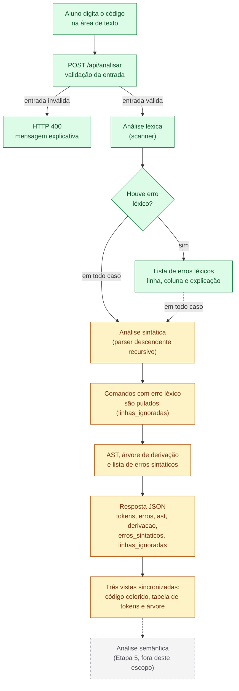

# Fluxograma do funcionamento

Este é o fluxo de uma análise, do código digitado na interface até as vistas
preenchidas na tela. A decisão de projeto que o diagrama registra é a do losango:
**o parser roda mesmo quando a análise léxica encontrou erro**, sobre os tokens
que foram reconhecidos. O aluno vê os dois tipos de erro de uma vez, em vez de
corrigir um erro léxico só para descobrir, na execução seguinte, que ainda havia
um erro de estrutura.

Caixas em verde são as etapas que já existem (Etapas 1 a 3). Em âmbar, o que a
Etapa 4 acrescenta. Em cinza tracejado, o que fica fora deste escopo.

## Legenda

| Cor | Significado |
| --- | --- |
| Verde | Já implementado nas Etapas 1 a 3 |
| Âmbar | Acrescentado pela Etapa 4 (parser, AST, árvore na interface) |
| Cinza tracejado | Fora do escopo desta entrega |

## Observações sobre o fluxo

A validação da entrada acontece antes da análise léxica e é a única saída que
não produz tokens: campo ausente, código vazio ou acima de 10.000 caracteres
devolvem HTTP 400 com mensagem explicativa, sem chegar ao scanner.

A seta tracejada que sai dos erros léxicos para a análise sintática é a que
expressa a decisão de projeto: a lista de erros léxicos é acumulada e exibida,
mas não interrompe o pipeline. O parser recebe os tokens reconhecidos e tenta
construir a árvore a partir deles, recuperando-se dos erros em modo pânico
sincronizado em `NOVA_LINHA`.

Detalhe da implementação: o parser **pula os comandos que contêm um erro
léxico** (da primeira linha do comando até a sua `NOVA_LINHA`). Como o scanner
descarta o trecho inválido, `x = 1 @ 2` chegaria ao parser como `x = 1 2`, e ele
apontaria uma "falta de operador" que o aluno não cometeu. As linhas puladas
voltam no campo `linhas_ignoradas` e são avisadas na tela. Os demais comandos são
analisados normalmente (caso CT-27).

O campo `sucesso` da resposta passa, a partir desta etapa, a significar ausência
de erros léxicos **e** sintáticos. A mudança está registrada na seção de
mudanças entre etapas do README.
